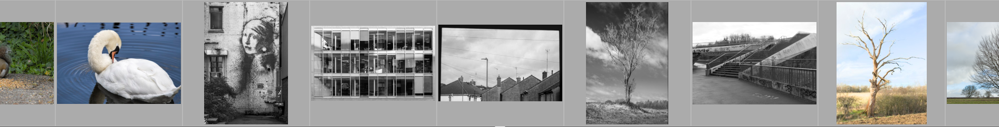

# left panel

From top to bottom:

[navigation](../module-reference/utility-modules/darkroom/navigation.md)
: Navigate and zoom the center view.

[snapshots](../module-reference/utility-modules/darkroom/snapshots.md)
: Take and view snapshots for comparison with the current edit.

[duplicate manager](../module-reference/utility-modules/darkroom/duplicate-manager.md)
: View and manage duplicates.

[global color picker](../module-reference/utility-modules/darkroom/global-color-picker.md)
: Select and display color information taken from parts of the image.

[tagging](../module-reference/utility-modules/shared/tagging.md)
: Manage tags.

[image information](../module-reference/utility-modules/shared/image-information.md)
: Display information about the current image.

[masking](../module-reference/utility-modules/darkroom/masking.md)
: Show the mask panel of the focused processing module (only if the mask panel is set to be shown as a utility module).

[export](../module-reference/utility-modules/shared/export.md)
: Export selected images to local files or external services.

[neural restore](../module-reference/utility-modules/shared/neural-restore.md)
: Apply AI-powered raw denoise, RGB denoise, or upscaling to selected images.

# right panel

From top to bottom:

[scopes](../module-reference/utility-modules/shared/scopes.md)
: A graphical depiction of the image's light levels and colors. This module can be moved to the left-hand panel if desired (see [preferences > miscellaneous > position of the scopes module](../preferences-settings/miscellaneous.md)).

[module groups](./organization/module-groups.md)
: Select module groups (if enabled).

search module
: Search for a module (if enabled).

[processing modules](../module-reference/processing-modules/_index.md)
: The modules used to process an image.

[module order](../module-reference/utility-modules/darkroom/module-order.md)
: Choose the order in which processing modules are executed in the pixelpipe.

# bottom panel

From left to right:

 [presets](./processing-modules/presets.md)
: Quick access menu for module presets. You can manage the contents of this menu by selecting "manage quick presets list...".

 [styles](../module-reference/utility-modules/shared/styles.md)
: Quick access menu for styles. Hover over a style name with your mouse to show a preview of the current darkroom image with the selected style applied.

 second darkroom window
: Allows the user to display a second image in a separate window. By default, the second window shows the same contents as the main view. When an image is "pinned" in the  second window, it will remain unchanged when making module changes, navigating the history stack or opening a different image in the main view. This is especially useful on large screens and multi-monitor setups.

 [focus peaking](../module-reference/utility-modules/shared/focus-peaking.md)
: Toggle focus peaking mode.

 [color assessment](../module-reference/utility-modules/darkroom/color-assessment.md)
: Toggle the ISO12646 color assessment view.

 [high quality processing](../module-reference/utility-modules/darkroom/high-quality-processing.md)
: Toggle high quality processing mode.

 [raw overexposed warning](../module-reference/utility-modules/darkroom/raw-overexposed.md)
: Toggle raw overexposed indicators (right-click for options).

 [clipping warning](../module-reference/utility-modules/darkroom/clipping.md)
: Toggle clipping warnings (right-click for options).

 [soft proof](../module-reference/utility-modules/darkroom/soft-proof.md)
: Toggle softproofing overlays (right-click for options).

 [gamut check](../module-reference/utility-modules/darkroom/gamut.md)
: Toggle gamut checking (right-click for options).

 [guides & overlays](../module-reference/utility-modules/darkroom/guides-overlays.md)
: Left-click to switch global guide overlays on/off and right-click to change the guide settings, including the color of all on-image drawing (masks, crop guides etc.)

 [mask panel](./masking-and-blending/masks/mask-panel.md)
: Show or hide the mask panel of the focused processing module. The icon is dimmed when the focused module has no mask. Right-click to open the [mask options](./masking-and-blending/masks/mask-panel.md#mask-options) without showing the panel.

## filmstrip

The [filmstrip](../module-reference/utility-modules/shared/filmstrip.md) module at the bottom of the screen allows you to select and interact with the currently selected collection.
