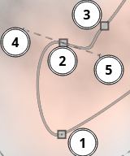

Drawn shapes are mask elements that you draw directly on the image: brush strokes, circles, ellipses, paths and gradients. Like any element, a shape can be combined with other elements in [groups](./groups-and-operators.md), and it can be reused in other modules. [AI objects](./ai-masking.md) are created in the same way, but differ from other shapes in that, by default, they are stored as pixels (a raster) and not as editable outlines -- see [how AI objects are stored](./ai-masking.md#how-ai-objects-are-stored).

Shapes are stored internally as vectors and are rendered with the required resolution during pixelpipe processing. Shapes are expressed in the coordinate system of the original image and are transformed along with the rest of the image by any active distorting modules in the pipe ([_lens correction_](../../../module-reference/processing-modules/lens-correction.md), [_rotate and perspective_](../../../module-reference/processing-modules/rotate-perspective.md) for example). This means that a shape will always work on the same image area regardless of any modifications that may be subsequently applied.

# creating shapes

Click on one of the shape buttons in the [toolbar](./mask-panel.md#toolbar) of the mask panel (from left to right: path, brush, circle, ellipse, gradient and AI object -- the latter if [AI features](../../../special-topics/ai/overview.md) are enabled and a model for the _mask_ task is active). If the mask is off, it is enabled.

This takes you into the creation mode for that shape. Draw the shape on the image (see [available shapes](#available-shapes) below). Once you have finished drawing it, the shape is added to the mask and you are taken into edit mode. While a shape is being drawn, its row in the [mask layout](./mask-panel.md#mask-layout) reads "new ..." and the [controls](./mask-panel.md#controls) section shows the settings it will start with. Press Escape or right-click to cancel.

The new shape is added to the selected group (or to the group of the selected element, or to the whole mask if nothing is selected). The operator of that group decides how it combines with the other members -- for example, with the default layout, shapes add up.

Ctrl+click on a shape button to continuously draw multiple shapes of the same type -- each time a shape is completed, you re-enter creation mode for a new instance of that shape. Right-click on the image or press Escape to stop drawing shapes and enter edit mode.

For all drawn shapes, the following operations are available in both creation and edit modes (as long as your mouse is over the shape in question):

- Shift+scroll changes the extent of the shape's feathering (the blur at the edge of the shape).
- Ctrl+scroll changes the shape's opacity.
- Dragging a node on the feathering outline changes the feathering shape. If the feathering node coincides with a path node, hold Shift when selecting the node to limit selection to feathering nodes.

By default, scrolling your mouse up increases the value of the relevant shape parameters. This behavior can be changed with the _scroll down to increase mask parameters_ option in the [mask options](./mask-panel.md#editing-options).

---

**Note:** When used in shape creation mode, the preceding scroll operations will also cause the _default_ feathering or opacity to be changed. The new default values will be used the next time you create a new shape. New shapes start with the opacity last used for a shape unless _remember last shape's opacity_ is disabled in the [mask options](./mask-panel.md#shape-element-options).

---

# editing shapes

Click the  _edit on canvas_ button in the [panel header](./mask-panel.md#panel-header) to show the shapes of the mask on the image and edit them. Ctrl+click on the same button to enter restricted edit mode, where certain actions (e.g. dragging a complete shape or changing its size) are blocked. This is particularly useful to avoid costly mistakes when editing path and brush shapes.

Hovering over a shape on the image highlights its row in the mask layout, and clicking on a shape selects it in the mask layout (and vice versa). To edit only the shapes of one group, select the group and enable  _solo edit_: the other shapes are then neither shown nor editable on the image, but they still contribute to the mask.

Click and drag a shape to move it around the image canvas.

Ctrl+click and drag within the shape to rotate it.

Shape nodes that lie close to or beyond the edges of the image can be edited: while _edit on canvas_ is enabled, the editing area extends beyond the image borders.

## shape controls

The [controls](./mask-panel.md#controls) section of the mask panel shows the settings of the selected shape (or of the shape under the mouse pointer). The shape's opacity is not listed here: it is shared by all members of the mask, so the _opacity_ slider is shown above the controls (see [controls](./mask-panel.md#controls)):

size
: The size of the shape.

hardness
: _Brush only._ How much of the stroke's width is at full opacity before it starts to fade out.

fade-out border
: The width of the feathered edge around the shape. Shift+scrolling over some shapes on the image can set a wider border than the slider allows.

rotation
: _Ellipse and gradient._ The rotation of the shape.

curvature, transition
: _Gradient only._ How much the gradient's line bends, and the width of its transition.

shrink or grow
: _Path only._ Grow (positive values) or shrink (negative values) the outline of the path, keeping its curves and nodes. Setting it to 0 restores the outline the path grew or shrank from. A change of size, feather, rotation or nodes makes the current outline the new starting point. Click the gear at the right of the slider to set the _step size_ used when scrolling over a path, the _unit_ (image pixels or a percentage of the path's size), the _tracing resolution_ and the _curve smoothing_ (smooth curves with few nodes, or a sharp polygon).

# removing shapes

Select the shape and click the  button in the [selection caption](./mask-panel.md#selection-caption), or press Delete. In edit mode, you can also right-click on a shape on the image to remove it.

A removed shape stays available in the image's list of shapes until it is cleaned up, and can be brought back with the [import](./mask-panel.md#toolbar) menu (_link shapes > not currently used_). Use _clean up unused shapes_ from the same menu to delete such shapes for good.

---

**Note:** darktable retains all shapes that have been defined for the current image unless you explicitly clean them up. If you choose to include develop history when exporting an image, all defined shapes are exported with the image. If the list of shapes is very long, the space required to store them might exceed the size limit of certain file formats, which can cause XMP tag creation to fail during export.

---

# reusing shapes

Shapes drawn in one module can be used in the mask of another, with the [import](./mask-panel.md#toolbar) button of the toolbar. The menu lists shapes by source module, by type, and those used most recently. Hover over an entry to preview the shape on the image.

link shapes
: Add the shape as a _linked_ shape: the same shape is shared by both modules, and editing it in one module changes it everywhere. A linked shape is shown with a dashed frame and a  link button in the mask layout: click the button to go to the next module that uses the shape, or Shift+click it to give this module its own copy. Each module keeps its own opacity, inversion and refinements for the shape.

copy shapes
: Add an independent copy of the shape, which can then be changed without affecting the original.

A shape can also be used more than once in the same mask (for example by importing it into another group). Such rows are linked too.

To reuse the _final_ mask of another module (all of its shapes, parametric elements and so on, as one element), use a [raster mask](./raster.md) instead.

# shape distortions

In order to ensure a consistent co-ordinate system, when you place a shape on the image, it is actually drawn on the original RAW file. This shape then passes up through the pixelpipe before finally being used by the module and drawn on the screen. This means that, if you have enabled any distorting modules (such as lens correction), drawn shapes may appear distorted on the screen and in the final image. This can lead, for example, to circles being rendered as ellipses and gradient lines becoming curved. If you need to create a more accurate shape (to overcome these distortions) it is recommended that you avoid using the simple shapes (circles / ellipses) in favor of the path shape (which can be drawn using more points, reducing distortions). You can adjust the curve on gradient lines to overcome the simple distortions introduced by lens correction.

# available shapes

 brush
: Start drawing a brush stroke by left-clicking on the image canvas and moving the mouse while keeping the button pressed. The brush stroke is finalized once you release the mouse button. Scroll the mouse to change the shape size and Shift+scroll to change the feathering (hardness), either before you start drawing or at any time during the operation. Likewise you can use the "`{`" and "`}`" keys to decrease/increase hardness, and the "`<`" and "`>`" keys to decrease/increase opacity.

: If you have a graphics tablet with pen pressure sensitivity, darktable can apply the recorded pen pressure to certain attributes of the brush stroke. While a brush stroke is being drawn, the _pressure_ setting in the [controls](./mask-panel.md#controls) section defines how the pressure is used: it can control the brush size, hardness or opacity. "Absolute" control means that the pressure reading directly defines the attribute with a value between 0% and 100%. "Relative" means that the pressure reading adjusts the attribute between zero and the pre-defined default value.

: On lifting the tablet pen or releasing the left mouse button the brush stroke is converted into a number of connected nodes, which define the final shape. The _smoothing_ setting (also shown in the controls section while drawing) controls how much smoothing is applied. A higher level of smoothing leads to fewer nodes being created – this eases subsequent editing at the expense of lower accuracy.

: Nodes and segments of a brush stroke can be modified individually. See the documentation on path shapes (below) for more details. Change the size or hardness of a node by scrolling and Shift+scrolling over a node, respectively.

: Brush strokes are often painted one after the other to build up a mask. To add up low-opacity strokes, put them in a group with the _sum (additive union)_ operator; to merge them without visible seams, use _screen (smooth union)_ (see [operators](./groups-and-operators.md#operators)). Long runs of strokes are [folded](./mask-panel.md#folded-runs) in the mask layout.

---

**Note:** Rendering a complex brush shape can consume a significant number of CPU cycles. Consider using the circle, ellipse or path shapes instead where possible.

---

 circle
: Click on the image canvas to place the circle. Scroll while hovering over the circle to change its diameter. Scroll while hovering over the circle's border to change the width of the feathering (the same effect as holding Shift while scrolling with the mouse wheel within the main shape).

 ellipse
: The general principle is the same as for the circle shape. In addition, four nodes are shown on the ellipse line. Click and drag the nodes to adjust the ellipse's eccentricity. Ctrl+click and drag the nodes or use Shift+Ctrl+scroll (with the mouse wheel) to rotate the ellipse. Alt+click within the shape to toggle the gradual decay between equidistant and proportional mode.

 path
: Click on the image canvas to place three or more nodes and generate a free-format enclosed shape. Terminate the path by right-clicking after having set the last point. By default, nodes are connected with smooth lines. If you want a node to instead define a sharp corner, you can do so by creating it with Ctrl+click.

: In edit mode Ctrl+click on an existing node to convert it from smooth to sharp corners and vice versa. Shift+click on one of the line segments to insert an additional node. Right-click on a node to delete it. Take care to ensure that the mouse pointer is over the desired node and the node is highlighted, to avoid accidentally removing the whole path.

: The size of the completed shape can be modified by scrolling. Normally resizing alters the boundary size by a constant distance (see _shrink or grow_ in [shape controls](#shape-controls)), but an alternative centroid-based resize which resizes the whole outline proportionally is activated with Ctrl+Shift+scroll.

: The width of the border (the area with a gradual opacity decay) can also be resized, with Shift+scroll (with the mouse wheel) from anywhere within the shape.

: Single nodes as well as path segments can be moved by dragging them with the mouse. If a node is selected by clicking on it, two Bézier handles appear which allow you to modify the curvature of the line (reset to the default curvature by right-clicking on either of the handles). In the image below, the selected node (2) has two handles (4 and 5). Altering the position or length of the handles alters the curvature between node 2 and the adjacent nodes (1 and 3).

: 

: Dragging one of the control points on the border adjusts the border width just in that part of the shape.

: Consider fine-tuning paths in restricted edit mode (enabled by Ctrl+clicking on the _edit on canvas_ button). This allows you to adjust single nodes and segments without the risk of accidentally shifting or resizing the whole shape.

: Changes made to a shape on the canvas are recorded as undo steps, so a sequence of changes can be undone one step at a time with Ctrl+Z.

 gradient
: The gradient shape is a linear gradient which extends from a given point to the edge of the image.

: Click the image canvas to place the gradient. The central line marks 50% opacity, the dotted lines to the sides indicate 100% and 0% opacity respectively. Between these dotted lines the opacity changes linearly. You can compress/expand the distance between the dotted lines by scrolling with your mouse wheel while pressing Shift. Note that the dotted lines will only appear while hovering over one of the lines with your cursor.

: The line has two anchor nodes which you can drag to change the rotation of the gradient. You can also set the rotation angle when placing the gradient shape by clicking and dragging to place the shape.

: Gradient lines can also be curved by scrolling with your mouse while hovering close to the center line. This can be useful to counteract the distortion caused by the [_lens correction_](../../../module-reference/processing-modules/lens-correction.md) module.

: Depending on the module and the underlying image, using a gradient shape might provoke banding artifacts. You should consider activating the [_dither or posterize_](../../../module-reference/processing-modules/dither-or-posterize.md) module to alleviate this.

 AI object _(requires AI features)_
: Click on a subject and let an AI model select it for you. See [AI masking](./ai-masking.md).

# inverting a shape

Click the  invert button on a shape's row to invert it. For example, a circle will, by default, cause the module to be applied only to the area inside the drawn circle. An inverted circle causes the module to apply everywhere _except for_ that circle. To invert the result of several shapes at once, invert the group that holds them -- see [inverting](./groups-and-operators.md#inverting).

# panning and zooming the image

While creating or editing a shape, mouse actions are applied to the current shape. If you need to move or zoom the portion of the image shown in the center view, hold down the 'a' key while dragging the mouse or using the scroll wheel. While the key is held down, the mouse actions will apply to the entire image rather than the current shape.
